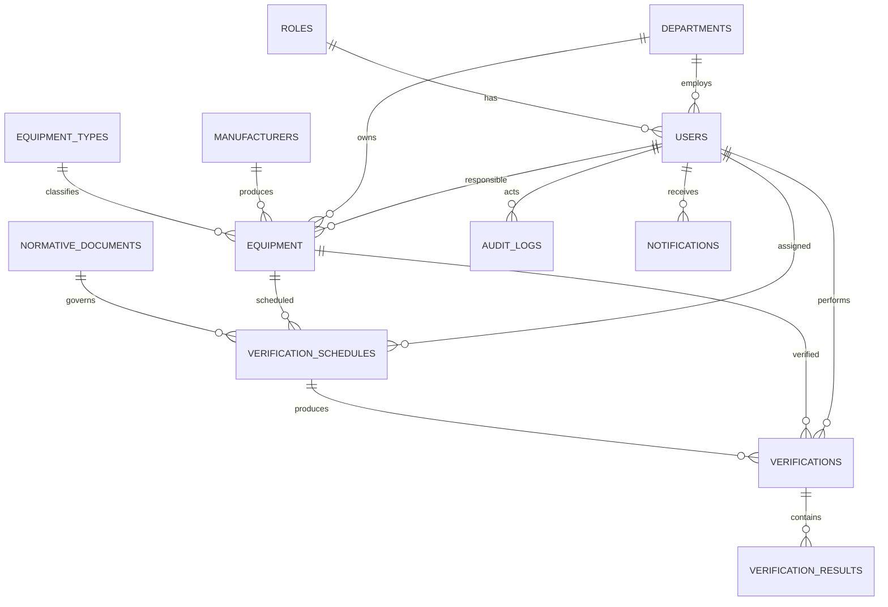

# Модель данных

## ERD

## Таблицы

| Таблица | Назначение |
|---|---|
| `roles` | роли пользователей |
| `departments` | подразделения |
| `users` | сотрудники и заказчики |
| `equipment_types` | типы СВЧ-оборудования |
| `manufacturers` | производители |
| `normative_documents` | нормативные документы и методики |
| `equipment` | реестр оборудования |
| `verification_schedules` | графики поверок |
| `verifications` | поверки |
| `verification_results` | результаты измерений |
| `audit_logs` | история действий |
| `notifications` | уведомления о сроках |
| `document_counters` | счётчики номеров протоколов и свидетельств |

## Ключевые ограничения

- `users.email` — уникальный индекс по `lower(email)`.
- `equipment.inventory_number` — уникальный.
- `equipment` — уникальная пара `manufacturer_id + serial_number`.
- `verification_schedules` — уникальная пара `equipment_id + planned_on`.
- `verifications.protocol_number` и `certificate_number` — partial unique indexes.
- `notifications` — уникальность события по пользователю, объекту, типу и сроку.
- Внешние ключи защищают ссылочную целостность.
- Check constraints проверяют положительный межповерочный интервал и счётчики.

## Нумерация документов

Номера протоколов и свидетельств формируются через `document_counters`.
Счётчик блокируется строкой (`SELECT ... FOR UPDATE`) внутри транзакции завершения
поверки. Это исключает выдачу одинаковых номеров при одновременной работе инженеров.